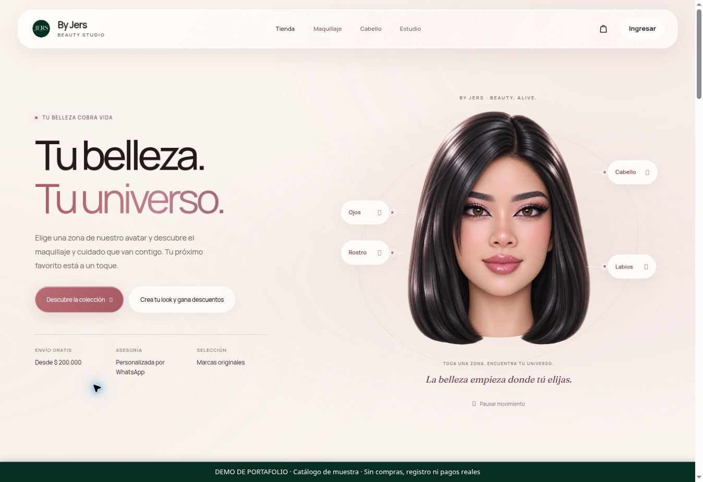
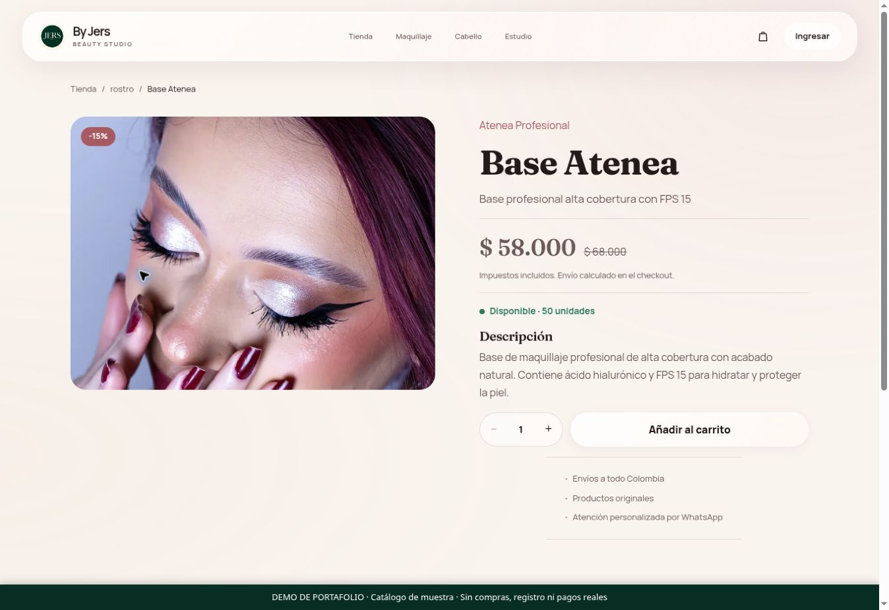
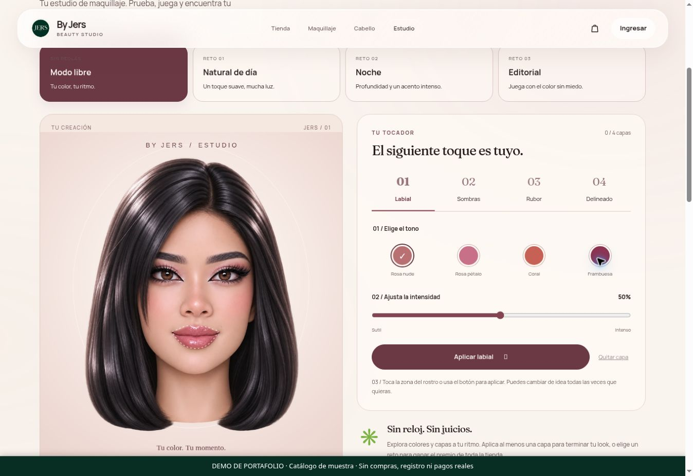

# By Jers

Tienda de maquillaje y cuidado capilar con Angular 20, una API Express y MongoDB. La raíz abre un recorrido arquitectónico 3D original de la boutique JERS; el scroll mueve la cámara desde la fachada hacia el interior. El comercio y el avatar aprobado viven en `/tienda`.

## Demo y recorrido visual

**[Abrir demo del frontend](https://by-jers-demo-juan-david.brightmanta3.chatgpt.site)** · [Cómo generar la demo](docs/demo/README.md)

Proyecto propio de formación y portafolio Full Stack. La demo pública permite explorar la bienvenida, la tienda, el catálogo, las fichas y el estudio de maquillaje. Usa productos de muestra del seed público; no está conectada a MongoDB ni admite cuentas, pedidos o pagos reales. El flujo de pedidos por WhatsApp del proyecto completo permanece sin cambios. No hay pasarela de pagos integrada.

### Recorrido 3D


[Ver video MP4 de escritorio](frontend/video/jers-store-entry-v1.mp4) · [Video móvil](frontend/video/jers-store-entry-mobile-v1.mp4) · [Video tablet](frontend/video/jers-store-entry-tablet-v1.mp4)

El GIF resume el video existente. El recorrido de la web reproduce un render 3D mediante el desplazamiento; no es una escena 3D renderizada en tiempo real.

### Capturas de la demo

| Bienvenida | Tienda y avatar |
| --- | --- |
|  |  |

| Catálogo | Ficha de producto |
| --- | --- |
|  |  |



Capturas reales del frontend ejecutado en modo demo, tomadas el 12 de noviembre de 2026 (UTC). Los precios y las existencias son datos de demostración.

Revisión local: **11 de noviembre de 2026**. Este documento reúne instalación, arquitectura, funcionamiento, auditoría, privacidad y pendientes operativos. Entrega académica de graduación en desarrollo web full stack. La demo visual se publica por separado; el despliegue operativo del backend y un dominio propio siguen pendientes. No se ha contratado ningún servicio nuevo ni una suscripción para producir el video.

## Componentes y estructura

| Carpeta | Contenido |
|---|---|
| `frontend/angular/src/app` | Componentes standalone, rutas diferidas, servicios, utilidades y pruebas TypeScript |
| `frontend/angular/src/app/bienvenida` | Bienvenida, diseño responsive y controlador de video asociado al scroll |
| `frontend/angular/src/app/home` | Tienda y retrato interactivo aprobado; WebGL con respaldo estático |
| `frontend/img` | Catálogo, marca, lookbook, avatar y posters de la boutique |
| `frontend/video` | Tres versiones MP4 del recorrido |
| `frontend/public` | Salida generada para servir el sitio; ignorada por Git, no editar |
| `backend/src/config` | Entorno, conexión MongoDB y Redis |
| `backend/src/routes` | Rutas públicas, de cuenta y administración |
| `backend/src/controllers` | Operaciones de catálogo, cuenta, carrito, pedidos, contacto y privacidad |
| `backend/src/models` | Esquemas e índices Mongoose |
| `backend/src/middleware` | Autenticación, roles, CSRF, validación, limitadores, errores y archivos privados |
| `backend/src/services` | Dinero, transacciones, inventario, correos y serialización de pedidos |
| `backend/tests` | Jest, Supertest y MongoDB temporal con replica set |
| `backend/thunder-tests` | Colección manual de API; utiliza variables privadas, no contraseñas incluidas |
| `api/index.js` | Adaptador serverless existente para Vercel |
| `scripts` | Compilación, pruebas, arranque local, selección GPU y generación de la boutique |
| `docs` | Procedencia JSON de los recursos gráficos y original del avatar; documentación centralizada aquí |
| `.github/workflows/ci.yml` | Instalación reproducible, detección de secretos, lint, tipos, pruebas y compilación |
| `output` | Evidencias locales y renders de trabajo ignorados; no se publican |

Frontend: Angular 20.3, TypeScript, SCSS, RxJS y SweetAlert2; fuentes Fraunces y Manrope alojadas localmente. Backend: Node.js 22, Express 4, Mongoose, Zod, bcrypt, JWT, Helmet y limitadores compartidos. SMTP, Redis y Sentry son integraciones opcionales según el entorno. No hay dependencias activas de Three.js ni GSAP.

## Instalación y desarrollo

Requisitos: Node.js **22.x**, npm, MongoDB y un navegador actualizado. Chrome, Chromium o Brave también permiten ejecutar las pruebas de Angular. La primera ejecución de las pruebas del backend descarga un binario de MongoDB si no está en caché.

Desde la raíz:

```bash
npm ci
npm ci --prefix frontend/angular
cp backend/.env.example backend/.env
node -e "console.log(require('node:crypto').randomBytes(64).toString('hex'))"
```

Guardar el secreto aleatorio generado en `JWT_SECRET` de `backend/.env`. No publicarlo ni usar las claves de CI en una instalación real. Configuración mínima de desarrollo:

```dotenv
NODE_ENV=development
HOST=127.0.0.1
PORT=3000
MONGODB_URI=mongodb://127.0.0.1:27017/by-jers
JWT_SECRET=
FRONTEND_URL=http://localhost:3000
API_ORIGIN=http://localhost:3000
FRONTEND_ALLOWED_ORIGINS=http://localhost:3000,http://127.0.0.1:3000,http://localhost:4200,http://127.0.0.1:4200
EMAIL_ENABLED=false
```

Completar `JWT_SECRET` antes de arrancar. Usar al menos 32 caracteres aleatorios en desarrollo y 64 en producción. Mantener el archivo privado, con permisos `0600` en Linux. El ejemplo completo está en [backend/.env.example](backend/.env.example).

```bash
npm start
```

Compila Angular y sirve **web y API en el mismo puerto**, normalmente `http://127.0.0.1:3000/`. `npm run dev` agrega recarga del backend. Para recarga de Angular, dejar el backend encendido y ejecutar `npm run dev:frontend`; abrir `http://localhost:4200/`. El proxy `/api` se define en `frontend/angular/proxy.conf.json`; ajustar su destino si el backend usa otro puerto o dirección. `HOST` determina dónde escucha: si se configura una IP de la red local, abrir esa dirección y añadirla a los orígenes permitidos.

La bienvenida funciona sin iniciar sesión ni consultar la API. La tienda consulta el catálogo y la sesión al entrar. Si el backend no responde, los componentes informan el fallo y permiten reintentar.

### Datos de demostración

El seed **reemplaza usuarios, categorías, marcas y productos**. Utilizarlo exclusivamente en una base desechable sin pedidos ni clientes existentes. No es una migración ni se ejecuta al arrancar. Está deshabilitado en producción y exige confirmación explícita:

```dotenv
SEED_CONFIRM_RESET=BORRAR_DATOS_DE_PRUEBA
SEED_ADMIN_EMAIL=admin@example.com
SEED_USER_EMAIL=cliente@example.com
SEED_ADMIN_PASSWORD=
SEED_USER_PASSWORD=
```

Asignar contraseñas distintas y aleatorias, de al menos 12 caracteres y como máximo 72 bytes UTF-8, en el entorno privado; después ejecutar `npm run seed`. No se incluye una contraseña pública predeterminada. Para una base existente, gestionar el catálogo con el panel o una migración revisada.

### Administrador y acceso a la entrega

El dashboard está en `http://127.0.0.1:3000/admin`. En el equipo de entrega, el administrador `admin@byjers.com` tiene una contraseña aleatoria nueva, guardada en **`backend/.env.admin-acceso.json`**, con permisos `0600`. Ese archivo es privado, está ignorado por Git y nunca se sirve desde la web; la contraseña no se incluye en este README ni en el repositorio público.

En otro equipo, crear un acceso propio después de configurar MongoDB:

```bash
npm run admin:create -- --email admin@example.com
```

El comando conserva los productos, pedidos y cuentas existentes. Si ese email ya corresponde a un administrador activo, exige `--rotate-existing` para renovar su contraseña y revocar sesiones; nunca asciende una cuenta de cliente ni reactiva una cuenta deshabilitada. Una nueva ejecución con el mismo archivo verifica el acceso vigente sin cambiarlo. Para otra rotación deliberada, indicar un archivo privado nuevo:

```bash
npm run admin:create -- --email admin@example.com --rotate-existing --output backend/.env.admin-nuevo.json
```

No enviar contraseñas como argumentos del shell. Para la evaluación, ejecutar los flujos en local con datos ficticios; SMTP puede permanecer desactivado explícitamente. El código de aprovisionamiento no tiene endpoint HTTP.

### Comandos

| Comando | Función |
|---|---|
| `npm start` | Compila el frontend y arranca Express |
| `npm run dev` | Compila y observa cambios del backend |
| `npm run dev:frontend` | Angular con recarga en puerto 4200 |
| `npm run build:static` | Genera `frontend/public` con recursos públicos filtrados |
| `npm run check` | ESLint y tipos de aplicación y pruebas Angular |
| `npm test` | Pruebas backend y Angular |
| `npm run test:backend -- --maxWorkers=2` | Backend con concurrencia acotada |
| `npm run test:angular` | Pruebas de Angular en ChromeHeadless |
| `npm run seed` | Reinicia los datos de una base exclusiva de demostración |
| `npm run admin:create -- --email correo@example.com` | Crea un administrador y guarda su acceso en un archivo privado |
| `npm run preview:gpu -- http://127.0.0.1:3000/` | Abre un perfil de navegador separado con NVIDIA PRIME en Linux |
| `npm run autostart` | Instala e inicia el servicio systemd de usuario |
| `npm run autostart:status` | Consulta el servicio |
| `npm run autostart:stop` | Detiene y retira ese servicio |

`CHROME_BIN` permite elegir el ejecutable para pruebas. En este equipo se restableció `HOST=127.0.0.1` después de un cambio de red que invalidó la IP anterior. Abrir `http://127.0.0.1:3000/`; si se desea revisar desde un dispositivo físico, configurar deliberadamente la interfaz LAN actual y sus orígenes permitidos. El servicio local se llama `by-jers-dev`; sus registros se consultan con `journalctl --user -u by-jers-dev -f`. Se reconstruye el frontend una sola vez antes de iniciar y reinicia el proceso ante fallos. Su continuidad después de cerrar sesión depende de la configuración de systemd del usuario; no sustituye un alojamiento público.

## Pantallas y comportamiento

| Ruta | Función |
|---|---|
| `/` | Boutique 3D con tres capítulos, scroll reversible y acceso directo a la tienda |
| `/tienda` | Inicio comercial y avatar interactivo aprobado |
| `/catalogo/maquillaje`, `/catalogo/cabello` | Búsqueda, categorías, marcas, orden y paginación |
| `/producto/:id` | Detalle, disponibilidad y añadir al carrito |
| `/looks` | Lookbook y enlaces al catálogo |
| `/carrito`, `/checkout`, `/pedidos` | Carrito propio, confirmación y seguimiento de pedidos |
| `/login`, `/register`, `/recuperar`, `/reset-password` | Acceso y recuperación |
| `/perfil`, `/direcciones`, `/mis-datos` | Datos de cuenta, entrega, exportación y solicitudes de privacidad |
| `/contacto` | Consulta con autorización de tratamiento y protección contra spam |
| `/admin` | Catálogo, categorías, marcas, pedidos, mensajes y solicitudes de datos |

Se conservan redirecciones internas de enlaces antiguos `.html`, incluidos correos de recuperación. Las rutas desconocidas muestran la pantalla de no encontrado. Las autorizaciones se comprueban en el backend; ocultar un control del panel no concede ni sustituye permisos.

El avatar utiliza once imágenes locales completas: mirada, parpadeo y deformación responden al puntero o al tacto. En móvil, el gesto vertical desplaza la página y el horizontal interactúa con el retrato. Los botones se mantienen fuera del rostro. No captura cámara ni micrófono. Si WebGL no está disponible, permanece el recurso estático.

### Compras y dinero

Los importes son **enteros en pesos colombianos**, calculados en `backend/src/services/money.js`. Por defecto, envío de $15.000, gratuito desde subtotal de $200.000; `TAX_RATE_BP=1900` añade 19% sobre subtotal más envío. Estas son reglas configurables del proyecto y deben ser aprobadas comercial y tributariamente antes de vender. El pedido conserva la tasa aplicada.

El carrito muestra precios vigentes. El checkout envía `expectedTotal` como confirmación de la cotización: **el servidor calcula el cobro**. Si cambió el importe, responde `409 PRICE_CHANGED`, no reserva stock ni crea un pedido, refresca el resumen y exige nueva confirmación. Las cantidades se acotan atómicamente a 1–99 por producto y al stock disponible.

`Idempotency-Key` evita duplicar una compra al reintentar. La misma clave del mismo usuario devuelve el pedido existente con su desglose y enlace de WhatsApp. Un checkout en curso bloquea mutaciones del carrito y la confirmación comprueba que no cambió desde la lectura. El servidor reserva stock con condiciones y transacciones; las cancelaciones devuelven únicamente unidades realmente aplicadas. Las actualizaciones administrativas detectan cambios simultáneos de estado o pago.

**No hay pasarela ni cobro automático.** Se genera un pedido pendiente y un enlace de WhatsApp con su referencia. El administrador confirma el pago y la preparación. Un pedido pagado necesita el flujo de reembolso, no una cancelación ordinaria; marcarlo reembolsado registra el estado, no transfiere dinero a un banco.

## Video original y uso de GPU

Boutique conceptual aprobada por el usuario, modelada con materiales procedurales: verde `#003D2F`, marfil `#F7F4E7` y latón `#C8A36B`. Las puertas se abren y la cámara entra entre los expositores hasta recepción. Generada localmente con **Blender gratuito**, sin activos de pago ni servicios externos de generación.

| Variante | Resolución | Tamaño aproximado |
|---|---|---|
| Escritorio y horizontal | 1440 × 810 | 9,25 MB |
| Celular vertical | 540 × 960 | 2,99 MB |
| Tableta vertical | 720 × 960 | 4,51 MB |

241 fotogramas originales a 24 fps, unos 10,04 segundos. MP4 H.264 con fotogramas I independientes, sin audio y con `faststart` para buscar con fluidez. Se selecciona una variante por dimensiones del viewport; al girar se conserva el avance. El controlador agrupa los destinos mientras hay una búsqueda en curso y libera recursos al abandonar la ruta. No reproduce automáticamente: el scroll determina `currentTime`.

Los posters son WebP locales del mismo render. Si el video falla o tarda, el catálogo sigue accesible. Con `prefers-reduced-motion: reduce`, se muestra el interior estático, se evita descargar el video y se elimina el recorrido largo. El diseño considera áreas seguras, controles táctiles y orientación. Las tablas administrativas tienen desplazamiento interno y sus columnas de grid permiten contraerse en pantallas estrechas.

El render final utilizó **Eevee de Blender 3.6.23 y la NVIDIA GTX 1050**, comprobado en el contexto OpenGL y en `nvidia-smi`. La compresión final utilizó FFmpeg/libx264 en CPU: NVENC de la versión instalada requiere un controlador más reciente que el disponible. El modelado, la compilación, MongoDB y las pruebas no se convierten en procesos CUDA por seleccionar la GPU del navegador.

Fuentes reproducibles:

- [scripts/render-boutique.py](scripts/render-boutique.py): escena, materiales, iluminación y animación.
- [scripts/render-boutique-film.py](scripts/render-boutique-film.py): render de los 241 fotogramas en Eevee/NVIDIA.
- [scripts/preparar-video-boutique.mjs](scripts/preparar-video-boutique.mjs): tres MP4, seis posters y procedencia.
- [docs/BOUTIQUE-GENERACION.json](docs/BOUTIQUE-GENERACION.json): parámetros y archivos finales.
- [docs/AVATAR-GENERACION.json](docs/AVATAR-GENERACION.json): procedencia del retrato y sus variantes.

Para reproducir el render validado, instalar Blender 3.6.23 y FFmpeg, ejecutar desde la raíz en una sesión gráfica Linux con NVIDIA PRIME, sustituyendo `/ruta/blender` por el ejecutable:

```bash
/ruta/blender -b --python scripts/render-boutique.py -- --scene-only
env -u WAYLAND_DISPLAY __NV_PRIME_RENDER_OFFLOAD=1 __GLX_VENDOR_LIBRARY_NAME=nvidia /ruta/blender --python scripts/render-boutique-film.py
node scripts/preparar-video-boutique.mjs
npm run build:static
```

La escena `.blend` y los PNG intermedios se guardan en `output/boutique`, no se publican. El render omite fotogramas existentes para reanudar; si se modifica la escena, utilizar una carpeta de render nueva o retirar deliberadamente esos intermedios antes de regenerar. La fuente también contempla Blender 4.2, pero el recorrido final se validó con 3.6.23; el render Eevee incluido requiere esa API y un contexto gráfico NVIDIA.

## API

Base `/api`; JSON, cookies con `credentials: include`. Las escrituras exigen `Content-Type: application/json`, origen autorizado y la cabecera `X-CSRF-Token` con el valor de la cookie técnica `jers_csrf`. `GET /api/auth/csrf` emite esa cookie. Límite del cuerpo: 256 kB. Nunca guardar JWT o contraseñas en localStorage.

| Grupo | Rutas principales |
|---|---|
| Salud | `GET /health` |
| Sesión | `POST /auth/register`, `/auth/login`, `/auth/logout`; `GET /auth/me`, `/auth/csrf` |
| Recuperación | `POST /auth/forgot-password`, `/auth/reset-password` |
| Perfil | `PATCH /auth/profile`, `/auth/password` |
| Direcciones | `POST /auth/addresses`; `PATCH/DELETE /auth/addresses/:addressId` |
| Datos propios | `POST /auth/data-export`; `GET/POST /auth/data-requests` |
| Catálogo | `GET /products`, `/products/:id`, `/products/featured`, `/products/promociones`, `/products/categorias`, `/products/marcas`, `/products/categoria/:slug`, `/products/buscar` |
| Carrito propio | `GET/POST/DELETE /cart`; `PATCH/DELETE /cart/:itemId` |
| Pedidos propios | `GET/POST /orders`; `GET /orders/:id`; `PATCH /orders/:id/cancelar` |
| Contacto | `POST /contact` |
| Usuarios, administrador | `GET /users`, `/users/:id`; `PATCH /users/:id/role`, `/users/:id/toggle-active`; `DELETE /users/:id` |
| Panel, administrador | `GET /admin/dashboard` |
| Catálogo, administrador | `GET/POST /admin/productos`, `/admin/categorias`, `/admin/marcas`; `PATCH/DELETE` de cada `/:id`; `GET /admin/categorias/:id/check-products`, `/admin/marcas/:id/check-products` |
| Pedidos, administrador | `GET /admin/pedidos`, `/admin/pedidos/:id`; `PATCH /admin/pedidos/:id` |
| Contactos, administrador | `GET /admin/contactos`; `PATCH /admin/contactos/:id` |
| Privacidad, administrador | `GET /admin/solicitudes-datos`; `PATCH /admin/solicitudes-datos/:id` |

El contrato de campos se mantiene en `backend/src/middleware/validation.js`. Registro exige `nombre`, `apellido`, `email`, `password`, `aceptoTerminos: true` y `aceptoPrivacidad: true`; teléfono opcional. Login usa `email`, `password`, `rememberMe?`. Cambiar contraseña usa `currentPassword`, `newPassword`; restablecer usa `token`, `password`, `confirmPassword`.

Direcciones: `alias`, `nombreCompleto`, `telefono`, `direccion`, `ciudad`, `departamento`, `codigoPostal?`, `esPrincipal?`. Carrito: `productoId`, `cantidad`; editar recibe `cantidad`. Consultar pedidos y exportar siempre filtra por la cuenta autenticada. Una dirección histórica del pedido no se modifica al editar el perfil.

Catálogo admite `page`, `limit` hasta 50, `categoria`, `marca`, `search`, `minPrice`, `maxPrice`, `enPromocion`, `destacado`, `sort`. Orden: `nuevos`, `mas_vendidos`, `precio_asc`, `precio_desc`, `descuento`. Los controladores públicos excluyen productos inactivos.

Contacto: `nombre`, `email`, `telefono?`, `mensaje`, `consentimiento: true`; el campo trampa `website` responde 202 sin guardar cuando se rellena. Exportación: `currentPassword`. Solicitudes: `currentPassword`, `tipo` (`acceso`, `supresion`, `revocacion`), `mensaje?`; la respuesta administrativa usa `respuesta`. Una solicitud pendiente no elimina automáticamente una cuenta.

Los errores utilizan:

```json
{"error":{"code":"VALIDATION_ERROR","message":"Datos de entrada inválidos","details":[{"field":"email","message":"Email inválido"}]},"requestId":"identificador"}
```

`details` es opcional; `requestId` existe cuando la petición pasó por Express. Usar `error.code` para decidir el comportamiento, no el texto. Los códigos completos están centralizados en `backend/src/middleware/apiError.js`.

| HTTP | Casos representativos |
|---|---|
| 400 | Validación, identificador inválido, cantidad fuera de rango, stock insuficiente |
| 401 | Sin sesión, credenciales incorrectas, token vencido/revocado, reautenticación fallida |
| 403 | Rol insuficiente, origen o CSRF rechazados |
| 404 | Recurso ausente o pedido ajeno |
| 409 | Checkout en curso, carrito cambiado, precio cambiado, transición o actualización concurrente |
| 413 / 415 | Cuerpo demasiado grande o tipo de contenido no admitido |
| 429 | Límite de peticiones |
| 503 | Base, correo, transacciones o configuración necesarios no disponibles |

Límites por defecto: general 100/15 minutos, autenticación 5/minuto, contacto 5/15 minutos, más límites sensibles por cuenta. Ajustables mediante entorno. En producción los contadores se comparten en MongoDB con TTL o Redis; no dependen de la memoria de una instancia serverless. El comportamiento ante caída del almacén evita abrir el límite silenciosamente.

## Seguridad y auditoría

Se revisaron frontend, controladores, modelos, validación, configuración, rutas, adaptador serverless, recursos y dependencias. Los cambios incluyen:

- Protección de precios y compras: cotización vigente, confirmación de cambios, idempotencia coherente, carrito bloqueado durante checkout y escrituras atómicas de cantidades.
- Inventario y pedidos: compensación de unidades efectivamente restauradas, detección de pagos/cambios concurrentes y transacciones obligatorias en producción. Reconocimiento de replica set y clúster sharded; un error de detección devuelve 503 y permite reintentar, sin degradar a escrituras sin transacción.
- Cuenta: cookies HttpOnly y Secure en producción, JWT con algoritmo/emisor/audiencia, rol y estado vigentes consultados en servidor, revocación al cerrar sesión o cambiar credenciales, sesiones administrativas limitadas y protección del último administrador.
- Formularios: esquemas de campos permitidos, límites de contraseña bcrypt de 72 bytes UTF-8, consultas acotadas, defensa CSRF/origen, prevención de enumeración en recuperación y enlaces de un solo uso guardados como hash.
- Cliente: respuestas antiguas no reponen sesión o carrito tras salir, navegación interna validada, token de recuperación retirado de la URL, solicitudes de producto protegidas ante respuestas fuera de orden y textos de alertas tratados como texto.
- Entrega: CSP sin CDN JavaScript, sin scripts inline autorizados, cabeceras de seguridad, respuestas privadas sin caché, archivos internos rechazados incluso ante una copia accidental al directorio público, y mapas de fuentes excluidos de publicación.
- Configuración: validación estricta en producción, secretos privados, SMTP con TLS cuando está habilitado, límites de conexiones/espera y diagnóstico sin cuerpos ni credenciales.
- Limpieza: retirada de los 153 fotogramas y canvas de bienvenida antiguos, frontend HTML/JS/CSS duplicado, videos anteriores, escena Three.js sin uso, fuentes duplicadas y dependencias asociadas. Se conservaron los recursos de catálogo y avatar que usa el proyecto.

Resultado de `npm audit` del 11/11/2026: **cero avisos conocidos en dependencias de producción**; **cero en Angular, incluidas las de desarrollo**. La raíz conserva cinco avisos bajos por la cadena de Jest que depende de `deepmerge <=4.3.1`, sin versión corregida publicada en el [aviso oficial](https://github.com/advisories/GHSA-gcqx-w48m-w2h4). No se instala en el servidor con `--omit=dev`. El ejecutor de pruebas aplica `--disable-proto=delete`; una regresión comprueba que el caso de contaminación del prototipo no altera el objeto. El aviso sigue visible hasta que exista un reemplazo o parche upstream; esta mitigación no se presenta como un parche publicado.

Los overrides actualizan glob y minimatch afectados; Karma conserva glob 7.2.3 y minimatch 3.1.5 para mantener su API, fuera de los rangos de los avisos de octubre de 2026. Consultas: [glob](https://github.com/advisories/GHSA-3g3m-2fjr-6pw4), [minimatch](https://github.com/advisories/GHSA-g3hv-75wg-m249). No sustituir globalmente una API antigua por una incompatible solo para silenciar el auditor.

Antes de la entrega a GitHub se analizaron los archivos entregables y más de cien commits locales con Gitleaks 8.30.1, además de comparar 1.154 objetos históricos con los secretos privados actuales. No se detectaron credenciales vigentes en esos objetos. Las dos apariciones de la contraseña histórica corresponden a una cuenta de prueba cuyo acceso ya fue renovado. El historial se conserva, sin una reescritura destructiva. La configuración de Gitleaks exceptúa únicamente dos literales ficticios en archivos de prueba concretos; cualquier otra credencial sigue analizándose. CI repite el escaneo con una descarga verificada por SHA-256, sin publicar los valores encontrados.

### Límites de la revisión y asuntos externos

Las pruebas verifican casos concretos; no constituyen una garantía de ausencia absoluta de vulnerabilidades. Antes de uso público deben resolverse los asuntos que dependen de cuentas, infraestructura o decisiones del responsable:

- **Credencial de prueba expuesta en historial:** los literales se retiraron del árbol actual. La auditoría previa confirmó que una contraseña histórica coincidía con una cuenta local. Se renovaron el administrador local y la cuenta de prueba que todavía aceptaba la contraseña expuesta en el historial. Sus sesiones anteriores quedaron revocadas y se comprobó que esa contraseña ya no autentica ninguna cuenta local. Si se reutilizó en servicios externos, se debe rotar allí también. Eliminar documentos o archivos no retira secretos del historial Git. No se ha reescrito el historial compartido.
- **Infraestructura:** validar acceso y titularidad de Atlas, usuarios mínimos, restricciones de red, TLS, copias de seguridad, recuperación y regiones. MongoDB local solo debe escuchar en loopback; la instalación de desarrollo no demuestra endurecimiento productivo.
- **Administrador:** no hay segundo factor implementado. Usar credenciales únicas, sesiones breves y acceso restringido; MFA queda como mejora pendiente, no como capacidad existente.
- **Correo:** verificar un SMTP real o mantener `EMAIL_ENABLED=false`; en ese modo no hay notificaciones ni recuperación por correo. No usar credenciales ficticias para aparentar disponibilidad.
- **Negocio y privacidad:** faltan responsable legal, canal oficial, políticas aprobadas, conservación y tratamiento comercial/tributario. No inventar datos para cerrar una auditoría técnica.

## Datos personales y privacidad

Este inventario describe el código, **no una política jurídica aprobada**. El contenido está orientado a Colombia; el responsable debe confirmar sede, público y si se usará como demostración o comercio real.

| Conjunto | Tratamiento y acceso |
|---|---|
| Cuenta | Nombre, apellido, email, teléfono opcional, hash bcrypt y aceptaciones. Perfil propio; proyecciones administrativas limitadas |
| Sesión | JWT firmado con ID y versión, sin nombre ni correo. Cookie de sesión HttpOnly; el rol vigente se comprueba en servidor |
| Recuperación | Token aleatorio enviado por SMTP, solo hash SHA-256 en MongoDB, validez de una hora y uso único |
| Direcciones | Datos de entrega propios; el pedido conserva una copia histórica |
| Carrito y pedidos | Productos, cantidades, importes, estados, dirección y notas. Sin tarjetas bancarias |
| Contacto | Nombre, email, mensaje y autorización registrada con fecha/versión; teléfono opcional. Acceso administrativo, sin marketing |
| Solicitudes | Tipo, mensaje, estado y respuesta. Exportación y alta de solicitudes requieren contraseña actual |
| Protección contra abuso | Contadores con expiración e identificadores técnicos seudonimizados; no se declaran anónimos |
| Diagnóstico | Tipo de error, código, ruta e identificador de petición. Sentry opcional con reducción de datos y sin trazas de rendimiento activadas |

La exportación JSON privada incluye perfil, direcciones, carrito, pedidos y solicitudes propios, sin hashes ni tokens. Se limita a 1.000 pedidos y 100 solicitudes e indica si es parcial. No incorpora mensajes públicos solo por coincidencia de email, porque el registro no verifica la titularidad del correo. Las solicitudes de supresión/revocación se registran para revisión; una respuesta administrativa no ejecuta un borrado ni elimina obligaciones de conservación.

Cookies: `token` (nombre configurable), HttpOnly, SameSite=Lax y Secure obligatorio en HTTPS productivo; sesión normal de un día, recordada hasta 30 días y administrador máximo una hora. `jers_csrf` es legible por JavaScript para enviarse en cabecera, firmada y con duración de ocho horas. Sin atributo Domain. No se persisten JWT ni contraseñas en localStorage. El retorno de navegación usa una ruta interna validada en la query; se retiró el almacenamiento de retorno antiguo.

En los flujos inspeccionados no hay analítica opcional, píxeles, publicidad ni captura de cámara/micrófono. No se añadió un banner de categorías inexistentes. Las fuentes, videos y recursos gráficos actuales se alojan localmente; si se incorporan imágenes externas, analítica o proveedores adicionales, repetir el inventario y resolver consentimiento antes de activarlos. WhatsApp solo se abre por acción del usuario y recibe la referencia del pedido; no se incluye la dirección en ese enlace.

No hay borrado automático por antigüedad de cuentas, contactos, carritos, pedidos o solicitudes; sus plazos y el tratamiento de backups deben definirse. Desactivar una cuenta no la elimina. Deben aprobarse términos, privacidad, cookies, finalidad, destinatarios, transferencias, retención, menores y canal de consultas antes de recoger datos de clientes reales. Referencias oficiales para revisar: [autorización informada, SIC](https://sedeelectronica.sic.gov.co/publicaciones/boletin-juridico/concepto/para-el-adecuado-tratamiento-de-los-datos-es-indispensable-la-autorizacion-expresa-previa-e-informada) y [cookies con datos personales, SIC](https://sedeelectronica.sic.gov.co/noticias/superindustria-abre-investigacion-la-empresa-plural-comunicaciones-sas-por-presunta-violacion-al-regimen-de-proteccion-de-datos-personales).

## Verificación

Las suites usan MongoDB temporal y datos ficticios; no sustituyen clientes ni pedidos locales. La revisión incluye tipos, lint, compilación, pruebas de dominio y recorridos de navegador. Resultado final: **441 pruebas automatizadas aprobadas (366 backend + 75 Angular)**; suite completa actual del backend (366 casos) y Angular aprobadas; la suite anterior de 362 casos también se verificó en UTC. Lint, tipos y compilación de producción aprobados. Además, 14 comprobaciones funcionales de interfaz, 23 de seguridad/privacidad, 12 de respaldo y tamaños del avatar, 6 táctiles y 59 de anchura de las pantallas comerciales y secciones administrativas: **224 comprobaciones de navegador** contando las 110 del recorrido. Las evidencias locales están en `output/playwright`, excluidas de Git y del despliegue. El servicio local reiniciado respondió HTTP 200 en bienvenida, salud y catálogo, y 206 al solicitar un rango del video.

La bienvenida se comprobó en Chromium y WebKit con 55 verificaciones por motor: PC 1440×900 y 1920×1080; iPad 768×1024, 820×1180 y 1180×820; celular 390×844, 320×568 y 844×390. Se verificaron fuentes de video, avance/retroceso, conservación al girar, controles sin superposición, ausencia de desbordamiento, movimiento reducido sin descarga, respaldo ante fallo, enlaces antiguos y ausencia de excepciones JavaScript. Son viewports emulados; no se afirma una prueba física en cada modelo de iPhone o iPad.

Para repetir las comprobaciones principales:

```bash
npm run check
npm run test:backend -- --maxWorkers=2
npm run test:angular
npm audit --omit=dev --audit-level=low
npm audit --prefix frontend/angular --audit-level=low
npm run build:static
```

CI ejecuta también el backend con `TZ=UTC` y `TZ=America/Bogota` para comprobar límites diarios de ingresos. Mantener los archivos lock y usar `npm ci` en ambas instalaciones.

## Alojamiento futuro, fuera de esta entrega

La arquitectura actual permite **un solo origen** para Angular y API. Se conserva el adaptador y configuración de Vercel como opción técnica, pero la elección de proveedor, condiciones comerciales y límites gratuitos se revisará en la fase de despliegue. No se ha provisionado AWS ni contratado nada en esta fase. La API pública anterior devolvía 503 en la comprobación previa; corregir el código local no demuestra que ese entorno ya esté configurado.

Para separar frontend y backend, preferir un proxy `/api` desde el dominio del frontend hacia la API: la cookie CSRF y las de sesión están diseñadas para el mismo origen. Cambiar solo una URL hacia otro dominio no resuelve la autenticación. CORS, cookies, CSRF, cabeceras, límites del proxy y redes deben probarse en la topología definitiva.

Requisitos de producción:

- Node.js 22; `NODE_ENV=production`, `SECRETS_FROM_ENV=true`, secreto JWT aleatorio de 64 o más caracteres, `JWT_ISSUER` y `JWT_AUDIENCE` propios.
- MongoDB con autenticación, TLS y **replica set o clúster sharded**. Las operaciones de stock/transacciones rechazan una base standalone en producción; la compensación standalone se limita a desarrollo/pruebas.
- `FRONTEND_URL`, `FRONTEND_ALLOWED_ORIGINS` y `API_ORIGIN` con los orígenes HTTPS reales; cookies Secure y configuración de proxy correspondiente al proveedor.
- `RATE_LIMIT_STORE=mongodb`, o Redis compartido con `RATE_LIMIT_STORE=redis`, `REDIS_ENABLED=true` y una conexión TLS `rediss://`.
- SMTP real o desactivación explícita; límites de conexión, recuperación, métricas, copias de seguridad y alertas verificadas.
- Base de presentación aislada si solo se va a demostrar el proyecto; nunca copiar datos personales locales por defecto.
- Construir con `PUBLIC_SITE_URL=https://dominio-real.example` para generar sitemap del origen correcto. Sin esa variable no se publica un sitemap con un dominio inventado.

No publicar `.env`, credenciales de aprovisionamiento, renders, informes privados, pruebas, cachés ni dependencias de desarrollo en el servidor de ejecución. Los archivos privados de preparación de proveedores permanecen fuera del repositorio; no intervienen en esta entrega local.

Después de configurar el alojamiento, comprobar `/`, `/tienda`, rutas SPA directas, los tres videos (incluido soporte de rangos HTTP), `/api/health`, registro, sesión, CSRF, catálogo, carrito, pedido idempotente, administración y recuperación real. Validar el plan gratuito y sus condiciones vigentes antes de elegirlo; no se promete coste cero permanente.

Licencia declarada del backend: ISC. La procedencia gráfica está indicada arriba; no convertirla en una afirmación general de derechos sobre recursos de terceros no inventariados.
